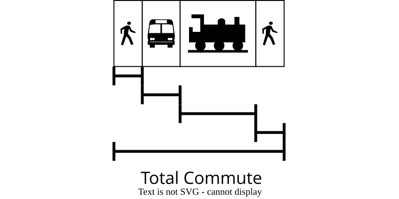
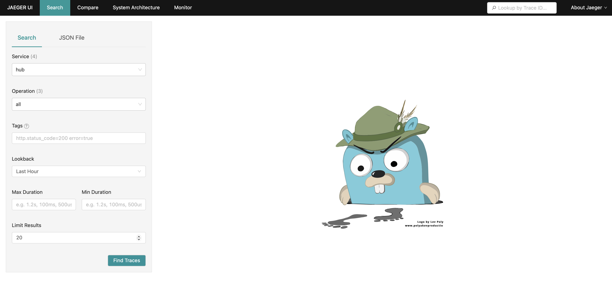
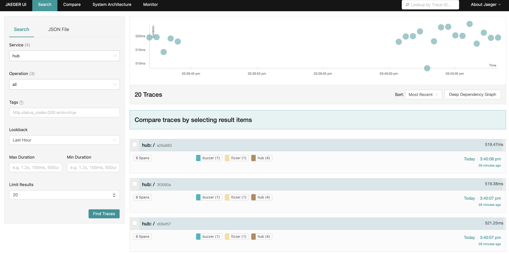
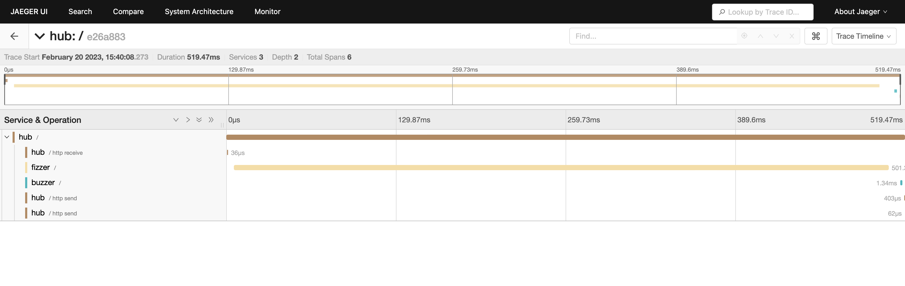
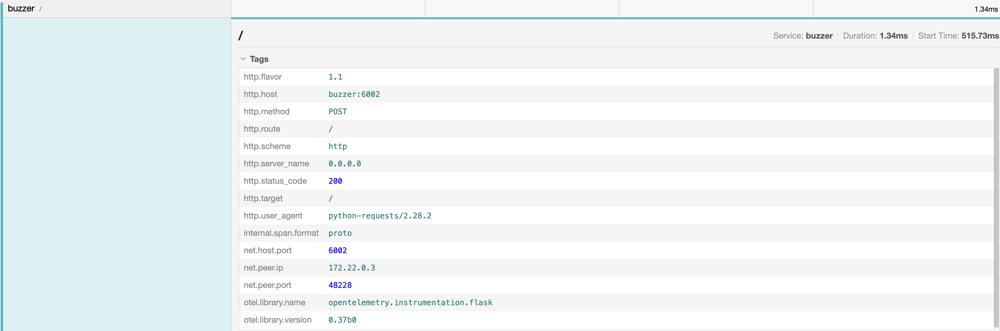
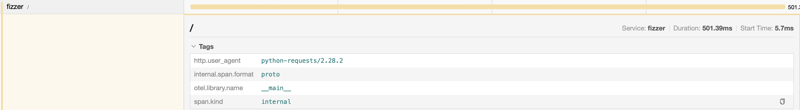

# {.title-card}

### Implementing Distributed Tracing

Zach Lipp (he/him/his)

Senior Machine Learning Engineer, Numerator

18 March 2023

---

### Roadmap

- What is distributed tracing?
- Tracing by metaphor
- Distributed tracing concepts
- Example system: Overview
- Example system: Jaeger
- How tracing works
- Example system: Code
- Tracing review

---

### What is distributed tracing?

Distributed tracing (hereafter tracing) is an observability tool

Tracing follows a request through a distributed system

---

### Tracing by metaphor

::: {.fragment}

#### Commuting

:::

---

### Tracing by metaphor


# {transition="none"}

### Tracing by metaphor



# {transition="none"}

### Tracing by metaphor


# {transition="none-out"}

### Tracing by metaphor


# {transition="none-in"}

### Tracing by metaphor


---

### Tracing by metaphor

::: {.fragment}

Knowing all commutes could help you understand:

- Of people late to work, what route did they take?
- Why was there so much more traffic on this one street? Where did they come from?
- How does delay in one system affect the system as a whole?

:::

# {.left}

### Distributed tracing concepts

::: {.fragment}

**Traces** follow a request through an entire system

:::

::: {.fragment}

**Spans** make up traces

:::

::: {.fragment}

**Tags** or **attributes** record information about spans

:::

::: {.fragment}

Tags don't have set schemas

:::

# {.left}

### Distributed tracing concepts

::: {.fragment}

Tracing is an open standard

:::

::: {.fragment}

Client: `opentelemetry` (formerly `opentracing`)

:::

::: {.fragment}

Server: `jaeger`

:::

---

### Example system: Overview

::: {.fragment}

**Fizzbuzz**

:::

::: {.fragment}

- Given an integer `x`:
  - If `x` is divisible by 3, return `"Fizz"`
  - If `x` is divisible by 5, return `"Buzz"`
  - If `x` is divisible by 15, return `"FizzBuzz"`

:::

---

### Example system: Overview

Introducing **FBaaS - FizzBuzz as a Service**

::: {.fragment}

https://github.com/zachlipp/pycascades_demo_2023

:::

---

### Example system: Overview



# {.left}

### Example system: Overview

We have the `hub` running at `localhost:6000`

It accepts JSON payloads `{"number": x}`

We'll use a bash for loop to fizzbuzz numbers 1-15

---

### Example system: Overview


---

### Example system: Overview

Seems kind of slow... let's trace it

(Available at branch `tracing-example`)

# {.left}

### Example system: Jaeger

From the `tracing-example` branch, run

```
docker-compose --profile tracing up
```

to run the traced service

::: {.fragment}

The `hub` service is still exposed at `localhost:6000`

:::

::: {.fragment}

The `jaeger` UI is now exposed at `localhost:16686`

:::

::: {.fragment}

After running some requests through the `hub`, we can view their traces at `localhost:16686`

:::

---

### Example system: Jaeger



---

### Example system: Jaeger



---

### Example system: Jaeger



This is what's called **the traceview**

---

### How tracing works

Two ways to think about that question:
1. How does this work under the hood?
2. What does the Python code for this look like?

---

### How tracing works

Programs need **context** to associate traces together

::: {.fragment}



:::

# {.left}

### How tracing works

::: {.fragment}

Tracing works by **propagating** HTTP headers through the system

:::

::: {.fragment}

`{"traceparent": "f"00-{trace_id}-{span_id}-00"}`

:::

::: {.fragment}

Check out the [W3C standards](https://www.w3.org/TR/trace-context/) for more information

:::

# {.left}

### How tracing works

::: {.fragment}

- The program creates a span associated with a trace

:::

::: {.fragment}

- The tracing client library (`opentelemetry`) sends the span to the the tracing backend (`jaeger`)

:::

::: {.fragment}

- The backend service accepts and stores the span

:::

::: {.fragment}

- A frontend allows users to visualize traces from the backend

:::

---

### Example system: Code


---

### Example system: Code

::: {.fragment}

`opentelemetry` has a rich collection of open source packages

:::

::: {.fragment}

It's even possible to `autoinstrument` popular servers
  - `FastAPI`
  - `Flask`

:::

::: {.fragment}

We'll look at `diff`s to emphasize what implementing tracing does

:::

---

### Example system: Code
#### Configure the exporter

::: {.fragment}

```python
from opentelemetry import trace
from opentelemetry.exporter.otlp.proto.grpc.trace_exporter import (
    OTLPSpanExporter,
)
from opentelemetry.sdk.resources import Resource
from opentelemetry.sdk.trace import TracerProvider
from opentelemetry.sdk.trace.export import BatchSpanProcessor

resource = Resource(attributes={"service.name": SERVICE_NAME})
trace.set_tracer_provider(TracerProvider(resource=resource))
tracer = trace.get_tracer(__name__)
otlp_exporter = OTLPSpanExporter(endpoint="http://jaeger:4317", insecure=True)
span_processor = BatchSpanProcessor(otlp_exporter)
trace.get_tracer_provider().add_span_processor(span_processor)
```

:::

# {transition="none"}

### Example system: Code
#### FastAPI (`hub/main.py`)

```python
def call_remote_service(
    number: float, service: Literal["fizzer", "buzzer"]
) -> bool:
    url = get_service_address(service)
    response = requests.post(url, json={"number": number})
    response_payload = response.json()
    return response_payload["result"]

app = FastAPI()

@app.post("/")
def fizzbuzz(nc: NumberContainer):
    number = nc.number
    fizz = call_remote_service(number, "fizzer")
    buzz = call_remote_service(number, "buzzer")
    ...

```

# {transition="none"}

### Example system: Code
#### FastAPI (`hub/main.py`)

```diff
+from opentelemetry.propagate import inject
+from opentelemetry.instrumentation.fastapi import FastAPIInstrumentor

def call_remote_service(
  number: int, service: Literal["fizzer", "buzzer"]
)
+    headers = {"Content-Type": "application/json"}
+    inject(headers)
-    response = requests.post(url, json={"number": number})
+    response = requests.post(url, json={"number": number}, headers=headers)

app = FastAPI()
+FastAPIInstrumentor.instrument_app(app)
```

# {transition="none-out"}

### Example system: Code
#### Flask (`buzzer/main.py`)

```python
from flask import Flask, jsonify, request

app = Flask(__name__)

@app.route("/", methods=["POST"])
def buzz():
    x = request.json["number"]
    buzz = bool(x % 5 == 0)
    return jsonify({"result": buzz})
```

# {transition="none-in"}

### Example system: Code
#### Flask (`buzzer/main.py`)

```diff
-from flask import Flask, jsonify, request
+import json
+
+from flask import Flask, make_response, request
+from opentelemetry.propagate import inject
+from opentelemetry.instrumentation.flask import FlaskInstrumentor

app = Flask(__name__)
+FlaskInstrumentor().instrument_app(app)

@app.route("/", methods=["POST"])
def buzz():
+    headers = {"Content-Type": "application/json"}
+    inject(headers)
     x = request.json["number"]
     buzz = bool(x % 5 == 0)
-    return jsonify({"result": buzz})
+    return make_response(json.dumps({"result": buzz}), 200, headers)
```

# {transition="none-out"}

### Example system: Code
#### Manual Flask (`fizzer/main.py`)

```python
from flask import Flask, jsonify, request

app = Flask(__name__)

@app.route("/", methods=["POST"])
def fizz():
    x = request.json["number"]
    fizz = bool(x % 3 == 0)
    return jsonify({"result": fizz})
```

# {transition="none"}

### Example system: Code
#### Manual Flask (`fizzer/main.py`)

```diff
+from opentelemetry import trace
+from opentelemetry.context import Context
+from opentelemetry.propagate import inject
+from opentelemetry.trace.propagation import tracecontext
+
+FORMAT = tracecontext.TraceContextTextMapPropagator()

@app.route("/", methods=["POST"])
def fizz():
-    x = request.json["number"]
-    fizz = bool(x % 3 == 0)
-    return jsonify({"result": fizz})
+    traceparent = request.headers.get("traceparent")
+    with tracer.start_as_current_span(
+        "/", context=FORMAT.extract({"traceparent": traceparent})
+    ) as fizzspan:
+        headers = {"Content-Type": "application/json"}
+        inject(headers)
+        x = request.json["number"]
+        fizz = bool(x % 3 == 0)
+        return make_response(json.dumps({"result": fizz}), 200, headers)
```

---

### Manual vs auto


---

### Manual vs auto


::: {.fragment}

```python
...
   with tracer.start_as_current_span(
       "/", context=FORMAT.extract({"traceparent": traceparent})
   ) as fizzspan:
         user_agent = request.headers.get("user-agent")
         fizzspan.set_attribute("http.user_agent", user_agent)
...
```

:::

---

### Python over! Now what?

::: {.fragment}

Let's talk about results!

:::

---

### Tracing review

::: {.fragment}

Tracing is clearly a complicated solution

:::

::: {.fragment}

This is a complicated problem

:::

# {.left}

### Tracing review
#### Lessons from my team

**Positives**:

::: {.fragment}

- My team identified a large bottleneck in our own codebase with autoinstrumentation
- After creating a manual span, we isolated a bottleneck to one of our dependencies
- [Configuring sampling](https://opentelemetry-python.readthedocs.io/en/latest/sdk/trace.sampling.html) is a joy

:::

**Negatives**:

::: {.fragment}

- Tracing is not a core part of our observability in practice
- We lack the tools to use traces to answer our questions

:::

# {.left}

### Tracing review
#### Alternatives

::: {.fragment}

[Service meshes](https://linkerd.io/2019/08/09/service-mesh-distributed-tracing-myths/) can identify latency

:::

::: {.fragment}

It's possible to approximate tracing without header propagation, see [Sachin Ashok and Vipul Harsh](https://www.youtube.com/watch?app=desktop&v=xSoF5XRx8l8)

:::

# {.left}

### Tracing review
#### Getting more value from tracing

::: {.fragment}

**Go beyond the traceview**

:::

::: {.fragment}

Services can operate on traces (e.g. demarcating types of traffic)

:::

::: {.fragment}

Teams can use traces to directly analyze traffic across service paths

:::

::: {.fragment}

[If traces are backed up to a SQL storage (or use a SQL-like tool)](https://danluu.com/tracing-analytics/), engineers can easily build custom analyses and tools

:::

::: {.fragment}

Please read [Cindy Sridharan's terrific post on tracing](https://copyconstruct.medium.com/distributed-tracing-weve-been-doing-it-wrong-39fc92a857df)

:::

# {.left}

### Summary

::: {.fragment}

- Because distributed tracing follows request through your whole system, it allows you to answer questions other tools can't

:::

::: {.fragment}

- Implementing distributed tracing can require substantial code changes

:::

::: {.fragment}

- To get the most value from tracing, plan to create or deploy tools to move your team beyond the traceview

:::
